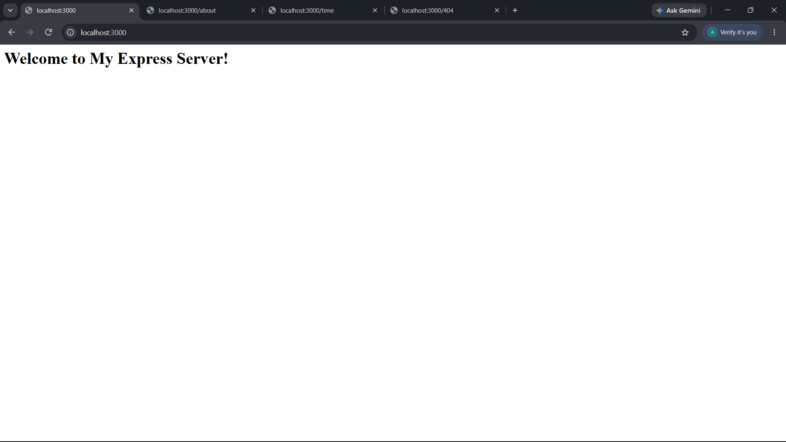
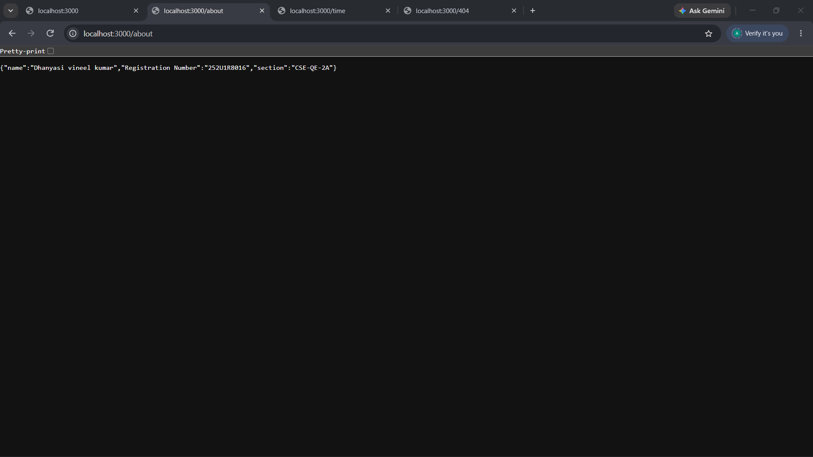
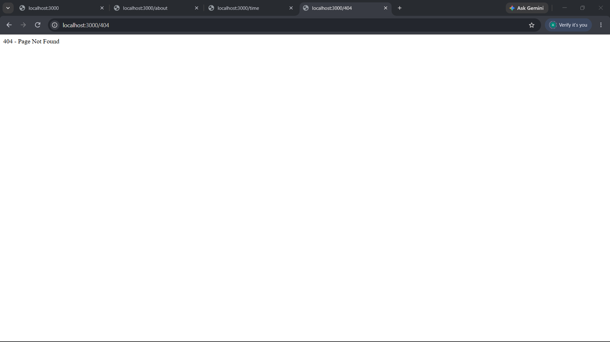

# Lab 1: Node.js and Express Server

## Student Details
- **Name:** Dhanyasi Vineel Kumar
- **Registration Number:** 252U1R8016
- **Section:** CSE-QE-2A

## Live Link
https://backend-development-fundamentals-lab-1-zhmi.onrender.com

## GitHub Repository
https://github.com/dvineel7-oss/Backend-Development-Fundamentals

## Project Description
This project demonstrates how to create a basic web server using Node.js HTTP module and Express.js.

## Technologies Used
- Node.js
- Express.js
- JavaScript

## How to Install and Run

1. Install Node.js.
2. Open the project folder in VS Code.
3. Open the terminal inside the `lab-01` folder.
4. Install dependencies:

```bash
npm install
```

5. Start the Express server:

```bash
node server.js
```

6. Open http://localhost:3000 in your browser.

## Endpoints

| Method | Path | Description |
|---|---|---|
| GET | `/` | Displays welcome message |
| GET | `/about` | Displays student details |
| GET | `/time` | Displays current date and time |
| GET | `/contact` | Returns 404 for unknown route |

## Screenshots

### Home Page


### About Page


### Time Page


### 404 Page


Problems Faced and Solutions

1. Setting Up the Node.js Server

Problem: Setting up the basic Node.js server and running it using the correct filename.

Solution: Created the HTTP server using Node.js and used the correct command, node http-server.js, to run it.

2. Installing Express.js

Problem: The project required the Express.js framework to implement routes.

Solution: Installed Express using npm install express and verified the installation.

3. Implementing Routes

Problem: The server needed to return different responses for different URL paths.

Solution: Created Express GET routes for the home page, about page, and current date and time.

4. Handling Invalid Routes

Problem: Requests to unknown URLs needed to return an appropriate error response.

Solution: Added fallback middleware that returns a 404 status code and a page-not-found message.

5. Deploying the Application

Problem: The application needed to be accessible through a public URL.

Solution: Uploaded the project to GitHub and deployed the Express server using Render.

Conclusion

This lab provided practical experience in creating web servers using Node.js and Express.js. It helped develop an understanding of HTTP requests and responses, route handling, JSON output, date and time operations, HTTP status codes, package management, Git version control, and cloud deployment using Render.